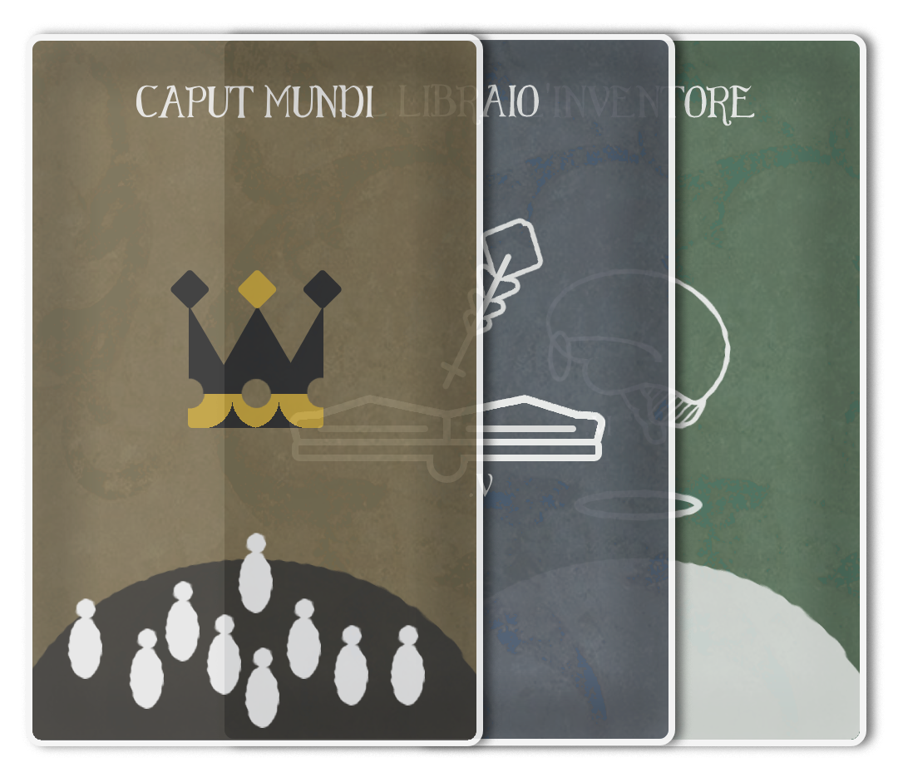

# MEMENTO

<p align="center">
  
</p>

### Un racconto interattivo — Gamebook engine in React

> _"Non tutto ciò che è dimenticato è perduto."_

---

## Panoramica

**Memento** è un motore per librogame narrativi costruito in React, pensato per il browser e ottimizzato per essere distribuito come **PWA** o app mobile tramite Capacitor. La storia si articola come un **grafo di nodi**: ogni nodo presenta testi, poi carte selezionabili, un lancio di dado, un tastierino PIN o un bottone "Continua". Link al gioco: [Memento](https://mementotest.netlify.app/)

**Capitolo 1** — Arklow, Irlanda. Mistery, thriller, esoterico: ti svegli in un albergo di quart'ordine senza ricordare chi sei. Il grafo di lavoro è in [`code/graph.md`](code/graph.md), la versione giocabile in `code/public/story.json`.

---

## Struttura del progetto

```
memento/
├── _material/                      # Sorgenti grafici (PSD, font, immagini)
└── code/
    ├── graph.md                    # Bozza narrativa del Capitolo 1
    ├── public/
    │   ├── story.json              # Grafo narrativo (dati separati dal codice)
    │   └── assets/                 # cards/, inventory/
    ├── scripts/
    │   └── validate-story.js       # Validatore di story.json (npm run validate)
    └── src/
        ├── App.jsx                 # Root: routing tra schermate, caricamento storia, autosave
        ├── engine.js               # Regole pure: nodi, inventario, flag, condizioni
        ├── db.js                   # Salvataggi su IndexedDB
        └── components/
            ├── audio.js            # Effetti sonori (Web Audio API)
            ├── music.js            # Colonna sonora procedurale per tema
            ├── audioContext.js     # AudioContext condiviso
            ├── Background/         # Canvas atmosferico + palette dei temi (themes.js)
            ├── CardFan/            # Ventaglio di carte (immagine o solo testo)
            ├── Dice/               # Dado d6 animato
            ├── PinPad/             # Tastierino del telefono per i nodi "pin"
            ├── GameScreen/         # Loop di gioco
            ├── InventoryModal/     # Inventario (carousel)
            ├── SideMenu/  TitleScreen/  SettingsScreen/  CreditsScreen/
```

Ogni componente ha la sua cartella con `Nome.jsx` + `Nome.css` (classi BEM-like, niente stili inline tranne valori dinamici).

---

## Formato di `story.json`

```json
{
  "title": "Memento — Capitolo 1",
  "start": "S01",
  "nodes": [ { "id": "S01", ... }, { "id": "S02", ... } ]
}
```

Ogni nodo ha un **`id` testuale** (l'ordine nell'array non conta), un `theme`, i `texts` mostrati uno alla volta e **una sola** meccanica d'uscita.

### Nodo con carte

```json
{
  "id": "S07B",
  "theme": "pub",
  "texts": ["Nell'angolo siede il vecchio Tadhg McSeagull..."],
  "cards": [
    {
      "textCard": "Sblocca il cellulare",
      "effectCard": "Forse il ritaglio c'entra",
      "cardPath": "./assets/cards/card_libraio.png",
      "requiresItem": "tessera_g",
      "nextNode": "S08"
    }
  ]
}
```

`cardPath` è facoltativo: senza immagine la carta viene disegnata in CSS con il titolo.

### Nodo con dado (con indizio)

```json
"dice": [
  { "range": [1, 3], "text": "Ti liquida senza aggiungere altro.", "nextNode": "S07" },
  { "range": [4, 6], "text": "Cogli un dettaglio...", "nextNode": "S07" }
],
"continueLabel": "Vai a pulire il bagno"
```

Gli intervalli devono coprire 1–6 senza sovrapposizioni. Se la regola ha `text`, il gioco lo mostra come **Indizio** e attende il bottone "Continua" (etichetta da `continueLabel`).

### Nodo PIN

```json
"pin": {
  "code": "1948",
  "nextNode": "S09",
  "prompt": "Inserisci il PIN",
  "errorText": "Non si sblocca...",
  "hint": "Suggerimento mostrato dopo hintAfter errori",
  "hintAfter": 3,
  "successText": "Sbloccato"
}
```

### Nodo "Continua" e nodo finale

```json
{ "id": "S03", "texts": ["..."], "nextNode": "S04", "continueLabel": "Scendi nella hall" }
{ "id": "S14", "texts": ["..."], "isEnd": true, "endLabel": "Fine Capitolo 1" }
```

Con `"autoAdvance": true` un nodo "Continua" passa avanti da solo dopo l'ultimo testo.

### Inventario, flag e condizioni

**Effetti** — su una carta, su una regola del dado o in `onEnter` (applicato all'arrivo nel nodo):

| Campo                 | Valore                                   | Effetto                                         |
| --------------------- | ---------------------------------------- | ----------------------------------------------- |
| `addToInventory`      | oggetto o array di oggetti               | Aggiunge; se l'oggetto ha `quantity`, si somma  |
| `removeFromInventory` | `"id"`, `{ "id", "quantity" }` o array   | Toglie tutto, oppure decrementa la quantità     |
| `setFlags`            | `"flag"` o array                         | Segna un fatto accaduto (es. `"tadhg"`)          |

Oggetto: `{ "id", "name", "description", "imagePath"?, "icon"?, "quantity"? }` — senza `imagePath` l'inventario mostra `icon` (emoji) tonalizzata.

**Condizioni** sulle carte: `requiresItem`, `hideIfItem`, `requiresFlag`, `hideIfFlag`.

### Temi

| Chiave    | Palette                  | Musica                                   |
| --------- | ------------------------ | ---------------------------------------- |
| `hotel`   | Ambra stanca             | Pianoforte scordato, orologio a cucù     |
| `pub`     | Verde scuro e ottone     | Giga in 6/8: bodhrán, pizzicato, violino |
| `street`  | Grigio-blu, mare d'Irlanda | Pioggia, battito, ostinato basso       |
| `library` | Ardesia                  | Esoterico: campane, violino lungo        |
| `mist`    | Viola freddo             | Rivelazione: drone dissonante           |
| `title`   | Indaco quasi nero        | Arpeggi di cimbalom                      |

Restano disponibili i temi della demo (`forest`, `forge`, `throne`, `dusk`, `dawn`).

---

## Validare la storia

```bash
npm run validate
```

Oltre ai controlli statici (id, temi, uscite verso nodi inesistenti, dadi che non coprono 1–6, immagini mancanti) il validatore **gioca tutte le partite possibili** con le stesse regole del motore e segnala:

- **vicoli ciechi**: nodi non finali senza nessuna scelta disponibile;
- **trappole**: situazioni da cui non si raggiunge più nessun finale (es. un oggetto necessario saltato);
- nodi mai raggiungibili.

Per ogni problema stampa il percorso che ci porta.

---

## Salvataggi (IndexedDB)

DB `memento-db`, store `saves` (keyPath `slot`). Autosave nello slot `"autosave"` a ogni cambio di nodo.

| Versione | Record                                                   |
| -------- | -------------------------------------------------------- |
| v1       | `{ slot, nodeIdx, inventory, timestamp }`                |
| v2       | `{ slot, nodeId, inventory, flags, timestamp }`          |

La migrazione v1 → v2 avviene in `onupgradeneeded` (`src/db.js`): i salvataggi v1 puntavano alla vecchia storia demo e vengono rimossi. "Continua" compare solo se il nodo salvato esiste ancora nella storia corrente.

---

## Audio

Tutto è generato via **Web Audio API**, senza file:

- `audio.js` — effetti (carte, dado, indizio, tasti/errore/sblocco del PIN, transizioni);
- `music.js` — colonna sonora procedurale nello stile "zingaro-vittoriano" alla Holmes con un tocco irlandese: pianoforte scordato, cimbalom (corde pizzicate Karplus–Strong), violino con glissando, bodhrán, scale minori armoniche e ungheresi, stop improvvisi. Le melodie sono generate al momento, nessuna è copiata. Ogni tema ha un suo mood e i cambi sono in dissolvenza.

Il volume musica e l'attivazione degli effetti si regolano da **Impostazioni**.

---

## Avvio in sviluppo

```bash
cd code
npm install
npm run dev        # dev server
npm run validate   # controlla story.json
npm run lint
npm run build      # build di produzione in dist/
```

> Il progetto usa **Vite 7 + React 19**. Richiede Node.js >= 18.

---

## Distribuzione

### Come PWA (consigliato — zero configurazione extra)

```bash
npm run build
# Carica la cartella dist/ su Netlify, Vercel, o qualsiasi hosting statico
```

### Come app mobile con Capacitor

```bash
npm install @capacitor/core @capacitor/cli
npx cap init
npm run build
npx cap add android   # oppure: npx cap add ios
npx cap sync
npx cap open android  # apre Android Studio
```

---

## Stack tecnico

| Tecnologia    | Uso                                |
| ------------- | ---------------------------------- |
| React 19      | UI e gestione dello stato          |
| Vite 7        | Build tool e dev server            |
| IndexedDB     | Salvataggi                         |
| Web Audio API | Effetti e colonna sonora procedurali |
| Canvas 2D API | Sfondo atmosferico animato         |
| CSS per componente | Stili senza dipendenze aggiuntive |

---

## Licenza

Progetto personale — tutti i diritti riservati.
Le illustrazioni delle carte sono opere originali dell'autore.
