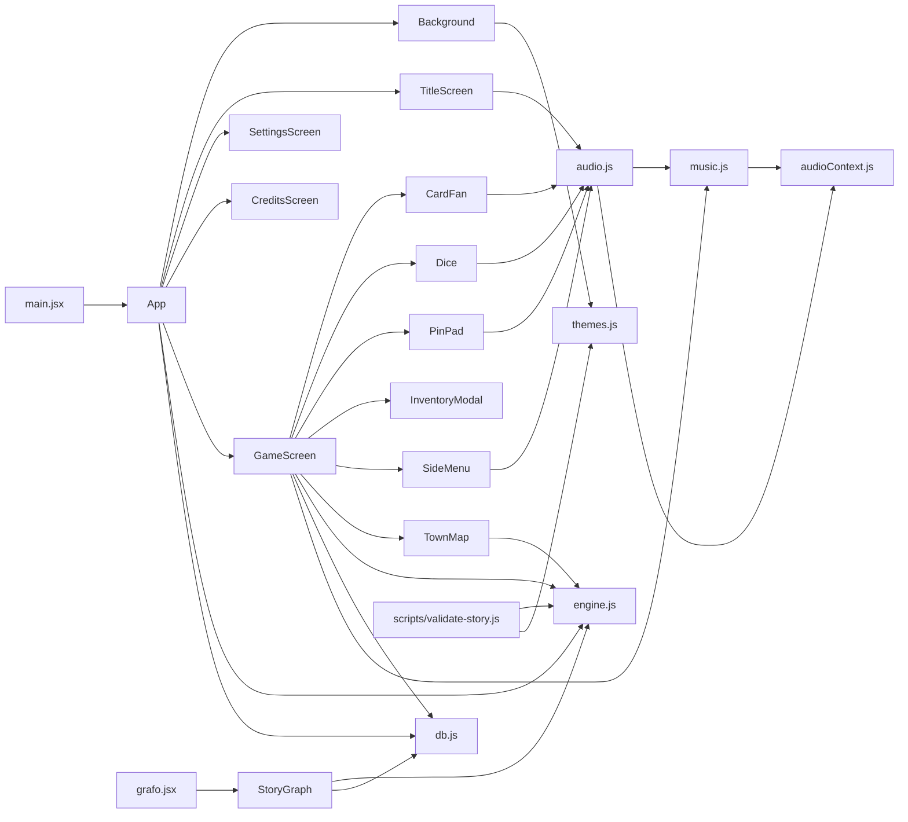
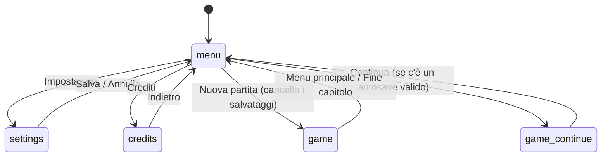
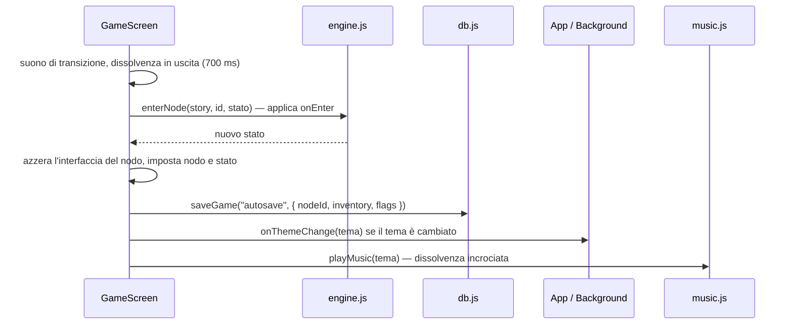

# 1. Architettura

## Cartelle

```
memento/
├── README.md               presentazione del gioco
├── docs/                   questa documentazione
├── _material/              sorgenti grafici: PSD delle carte, font, immagini (non usati a runtime)
└── code/                   l'applicazione
    ├── index.html          pagina del gioco
    ├── grafo.html          pagina di sviluppo /grafo (esclusa dalla build)
    ├── graph.md            bozza narrativa del Capitolo 1 e modifiche successive
    ├── vite.config.js      configurazione Vite (solo il plugin React)
    ├── eslint.config.js
    ├── public/             copiato così com'è nella build
    │   ├── story.json      la storia
    │   ├── favicon.png
    │   └── assets/cards/, assets/inventory/
    ├── scripts/
    │   └── validate-story.js
    └── src/
        ├── main.jsx        monta <App/>
        ├── grafo.jsx       monta <StoryGraph/>
        ├── App.jsx         router delle schermate, caricamento della storia, autosave
        ├── engine.js       regole del gioco
        ├── db.js           IndexedDB
        ├── index.css       reset, font dei titoli, stili di base
        ├── App.css         contenitore e grana di carta
        ├── assets/fonts/   Elementary Gothic Bookhand + licenza OFL
        └── components/
            ├── audioContext.js, audio.js, music.js
            ├── Background/      canvas atmosferico + themes.js
            ├── TitleScreen/  SettingsScreen/  CreditsScreen/
            ├── GameScreen/      il loop di gioco
            ├── CardFan/  Dice/  PinPad/      le tre meccaniche di scelta
            ├── InventoryModal/  SideMenu/
            ├── TownMap/         mappa di Arklow (ArklowBase = la carta in SVG)
            └── StoryGraph/      grafo della storia (solo sviluppo)
```

Convenzione: ogni componente ha una cartella con `Nome.jsx` e `Nome.css`. Le classi CSS seguono uno schema BEM (`blocco__elemento--modificatore`, per esempio `game-screen__text--current`). Gli stili inline sono riservati ai valori calcolati a runtime (rotazione delle carte, colore di categoria nel grafo).

## Dipendenze tra moduli



`engine.js` e `themes.js` non dipendono da niente: per questo il validatore li può importare in Node.

## Le schermate

Non c'è un router: `App.jsx` tiene una variabile `screen` e mostra il componente corrispondente. Lo sfondo (`Background`) resta montato sempre, così i cambi di schermata non interrompono l'animazione.



`game` e `game-continue` montano lo stesso `GameScreen`, con `key={screen}`: passando dall'uno all'altro il componente viene ricreato da zero invece di riusare lo stato precedente.

## Dove vive lo stato

| Stato | Dove | Persistenza |
| ----- | ---- | ----------- |
| Schermata corrente, tema dello sfondo | `App` | nessuna |
| Impostazioni (volume, effetti, velocità del testo) | `App` | **nessuna**: si perdono ricaricando la pagina |
| Storia caricata | `App` | rilette da `story.json` a ogni avvio |
| Nodo corrente, inventario, flag | `GameScreen` | autosave in IndexedDB a ogni cambio di nodo |
| Testi già mostrati, scelta in corso, menu aperto | `GameScreen` | nessuna |
| Cifre del PIN, errori | `PinPad` | nessuna (si azzerano uscendo dal tastierino) |

Lo **stato di gioco** è un oggetto semplice, `{ inventory: Item[], flags: string[] }`, sempre sostituito e mai modificato sul posto: è quello che `engine.js` trasforma e `db.js` salva.

## Una partita, passo per passo

1. **Avvio.** `App` scarica `story.json` (dall'URL `import.meta.env.BASE_URL + "story.json"`, così funziona anche se il sito è servito da una sottocartella) e lo passa a `buildStory`, che lo indicizza per id e lancia un errore se è inutilizzabile.
2. **Menu.** Ogni volta che si torna al menu, `App` rilegge lo slot `"autosave"`. «Continua» compare solo se il nodo salvato esiste ancora nella storia (la storia può cambiare tra un aggiornamento e l'altro) e non è il nodo iniziale.
3. **Ingresso in un nodo.** `GameScreen` mostra i testi uno alla volta (700 ms per il primo, poi 2,2 / 1,5 / 0,9 s a seconda della velocità scelta), poi la meccanica del nodo.
4. **Scelta.** La carta, il dado o il PIN producono un nuovo stato con `applyEffects` e chiamano `goTo(id, stato)`.
5. **Cambio di nodo** (`goTo`):



6. **Fine.** Su un nodo con `isEnd` compare la scritta di fine capitolo e il pulsante per tornare al menu.

### I timer e lo smontaggio

`GameScreen` usa molti ritardi (dissolvenze, pausa dopo la scelta di una carta). Passano tutti da una funzione `later()` che registra il timer in un `Set`; quando il componente viene smontato (per esempio tornando al menu durante una transizione) i timer vengono cancellati, così non parte un cambio di nodo o un autosave «fantasma». Lo stato più recente è letto da `gameRef`, un ref aggiornato a ogni render, per evitare che un timer usi uno stato vecchio catturato nella sua closure.

## Due pagine, una sola build

`vite build` impacchetta solo `index.html`. La pagina `grafo.html` esiste solo nel dev server (`/grafo`): mostra l'intera storia, quindi non deve finire sul sito pubblico. Vedi [Strumenti](07-strumenti.md#grafo-della-storia).
