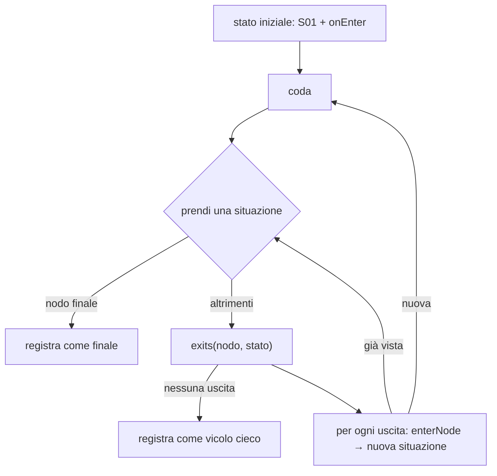

# 3. Il motore: `src/engine.js`

`engine.js` contiene **tutte le regole** del librogame e nient'altro: non importa React, non tocca il DOM, non salva niente. Riceve dati e restituisce dati. Questo lo rende:

- **condivisibile**: lo usano il gioco (`GameScreen`, `App`), il validatore (Node) e il grafo della storia;
- **prevedibile**: le funzioni non modificano mai i loro argomenti, restituiscono oggetti nuovi;
- **facile da testare**: basta chiamare una funzione e guardare il risultato (oggi non ci sono test automatici; vedi [Analisi](08-analisi.md)).

## Lo stato di gioco

```js
{ inventory: Item[], flags: string[] }
// Item: { id, name, description, imagePath?, icon?, quantity? }
```

È anche esattamente ciò che si salva (più il nodo corrente). `EMPTY_STATE` è lo stato di partenza, congelato con `Object.freeze` per evitare modifiche accidentali.

## Le funzioni

### Storia

| Funzione | Cosa fa |
| -------- | ------- |
| `buildStory(raw)` | Trasforma il JSON in `{ title, start, nodes: Map<id, nodo> }`. Lancia un errore se manca l'array dei nodi, se un nodo non ha id, se un id è duplicato o se il nodo iniziale non esiste |

La `Map` permette di trovare un nodo per id in tempo costante (`story.nodes.get("S08")`).

### Inventario, flag, effetti

| Funzione | Cosa fa |
| -------- | ------- |
| `hasItem(state, id)` | `true` se l'oggetto è nell'inventario |
| `hasFlag(state, flag)` | `true` se il flag è impostato |
| `applyEffects(state, source)` | Applica gli effetti di una carta, di una regola del dado o di un `onEnter`: prima `removeFromInventory`, poi `addToInventory`, poi `setFlags`. Se non cambia niente restituisce **lo stesso oggetto** `state` (utile per confronti rapidi) |
| `enterNode(story, id, state)` | Lo stato dopo l'arrivo nel nodo `id`: prima il suo `onEnter`, poi i flag dei luoghi (`visitato:<location>`, `sentito:<reveals>`) |
| `mapProgress(story, state, nodeId)` | Per la mappa: luoghi visitati (nell'ordine di scoperta), luoghi solo sentiti nominare, luogo attuale |

### I luoghi come flag

La mappa non ha uno stato suo: i luoghi conosciuti sono **flag normali** con un prefisso (`VISITED = "visitato:"`, `HEARD = "sentito:"`), aggiunti da `enterNode`. Scelta voluta:

- **niente modifiche al salvataggio**: il record di IndexedDB ha già `flags`, quindi non serve un campo nuovo né una nuova versione del database (vedi [Salvataggi](04-salvataggi-indexeddb.md));
- **l'ordine di scoperta è gratis**: `applyEffects` aggiunge i flag in coda, quindi l'array `flags` è già in ordine cronologico, ed è da lì che la mappa disegna il percorso;
- **validatore e grafo li vedono già**: l'esplorazione li tratta come gli altri flag. Siccome nel Capitolo 1 i luoghi stanno sul percorso obbligato, non aumentano le situazioni di gioco (sono sempre 621).

Regole sugli oggetti (funzioni interne `addItem` / `removeItem`):

- un oggetto **con** `quantity` è cumulabile: aggiungerlo di nuovo somma le quantità;
- un oggetto **senza** `quantity` è unico: aggiungerlo di nuovo non fa niente;
- togliere per id elimina l'oggetto; togliere `{ id, quantity }` decrementa e, arrivati a zero, lo elimina.

### Scelte disponibili

| Funzione | Cosa fa |
| -------- | ------- |
| `meetsConditions(obj, state)` | Verifica `requiresItem`, `hideIfItem`, `requiresFlag`, `hideIfFlag` su una carta o un testo (`isCardVisible` è lo stesso, col vecchio nome) |
| `conditionsOf(obj)` | Le condizioni impostate, come `{ chiave: valore }` |
| `visibleCards(node, state)` | Le carte del nodo che il giocatore vede in quello stato |
| `visibleTexts(node, state)` | I paragrafi che il giocatore legge in quello stato, come stringhe (i testi condizionati filtrati) |
| `textOf(t)`, `isConditionalText(t)` | Il testo di un paragrafo (stringa o oggetto) e se ha condizioni |
| `findDiceRule(node, roll)` | La regola del dado il cui intervallo contiene il risultato |
| `nodeKind(node)` | La meccanica del nodo: `"end"`, `"cards"`, `"dice"`, `"pin"`, `"continue"` o `"none"` (nessuna uscita: errore) |

### Uscite: due punti di vista

| Funzione | Domanda a cui risponde | Chi la usa |
| -------- | ---------------------- | ---------- |
| `exits(node, state)` | Dove può andare il giocatore **adesso**, con questo inventario e questi flag? Restituisce `[{ to, state, label }]` con lo stato già aggiornato dagli effetti della scelta | `explore` (validatore, grafo) |
| `staticExits(node)` | Quali uscite **esistono** nel nodo, ignorando le condizioni? Restituisce `[{ to, label, kind, conditions, source }]` | il grafo, per disegnare tutte le frecce |

Per il dado `exits` restituisce **tutte** le regole: ogni risultato è possibile. Per il PIN, l'uscita «corretta» più, se c'è, l'uscita `leave`.

### Esplorare tutte le partite: `explore(story, maxStates = 50000)`

È il cuore del validatore e del grafo. Visita **ogni situazione di gioco raggiungibile**, dove una situazione è la combinazione *nodo + inventario + flag*. Due giocatori nello stesso nodo ma con inventari diversi sono in due situazioni diverse, perché possono vedere carte diverse.



Dettagli:

- **Chiave della situazione**: `stateKey(id, stato)` produce una stringa come `S08|cellulare:1,fiammiferi:2|tadhg`. Oggetti e flag sono ordinati, così lo stesso insieme dà sempre la stessa chiave.
- **Ricerca in ampiezza (BFS)**: si esplora prima tutto ciò che dista un passo, poi due, e così via. Di conseguenza, la prima volta che si incontra un nodo ci si è arrivati con il **percorso più breve**. Il grafo usa proprio quella situazione per «Gioca da qui».
- La coda è un array letto con un indice (`head`) invece di `shift()`, che su array lunghi costa O(n) a ogni chiamata.
- **Limite**: oltre `maxStates` situazioni l'esplorazione si ferma e segnala `truncated: true`. Il Capitolo 1 ha 35 nodi e 1183 situazioni. Le situazioni crescono molto più in fretta dei nodi: aggiungendo 6 nodi e 3 flag facoltativi (`dipinto`, `mano_ferita`, `zohar`) si era passati da 136 a 621, perché ogni flag che si può avere o non avere moltiplica le combinazioni possibili nei nodi successivi; il totem della biblioteca, con i suoi esiti, le ha quasi raddoppiate. Il limite serve per storie future con molti flag e oggetti cumulabili.

Restituisce:

| Campo | Contenuto |
| ----- | --------- |
| `states` | `Map<chiave, { id, state, parent, via }>`: `parent` e `via` (la scelta fatta) permettono di ricostruire il percorso |
| `edges` | `Map<chiave, chiavi[]>`: il grafo delle situazioni |
| `endKeys` | situazioni su un nodo finale |
| `deadEnds` | situazioni senza nessuna scelta disponibile |
| `truncated` | `true` se si è raggiunto il limite |

## Come il validatore usa `explore`

`scripts/validate-story.js` fa due passate.

1. **Controlli statici**, nodo per nodo: id, testi (stringhe o testi condizionati ben formati), tema esistente, una sola meccanica, carte con `textCard`, immagini esistenti in `public/`, dadi che coprono 1–6 senza sovrapposizioni, PIN numerico, uscite verso nodi esistenti, luoghi della mappa esistenti. Le condizioni di carte e testi devono usare oggetti che qualche nodo dà davvero (errore) e flag che qualche nodo imposta (avviso; i flag dei luoghi `visitato:`/`sentito:` contano come impostati).
2. **Esplorazione** con `explore`, poi:
   - **vicoli ciechi**: le `deadEnds`;
   - **trappole**: situazioni da cui non si raggiunge più nessun finale. Si trovano al contrario: si parte dai finali e si risale il grafo delle situazioni (`edges` invertito); quello che non si raggiunge risalendo è una trappola. Per ciascuna si riporta solo la prima situazione (quella il cui genitore poteva ancora finire), con il percorso per arrivarci;
   - **nodi senza testo**: una situazione in cui i testi condizionati di un nodo sono tutti nascosti;
   - **nodi irraggiungibili**: nodi che nessuna situazione visita (avviso).

Esce con codice 1 se ci sono errori, così può bloccare una pipeline di pubblicazione.

## Come il gioco usa il motore

- `App`: `buildStory` all'avvio.
- `GameScreen`:
  - `enterNode` a ogni cambio di nodo e per la partita nuova;
  - `nodeKind` per decidere cosa mostrare;
  - `visibleCards` per il ventaglio;
  - `findDiceRule` + `applyEffects` dopo il lancio;
  - `applyEffects` alla scelta di una carta.

## Estendere il motore

Per aggiungere una nuova meccanica (per esempio una «parola d'ordine» da digitare):

1. `nodeKind`: riconoscere il nuovo campo;
2. `exits` e `staticExits`: elencarne le uscite;
3. `scripts/validate-story.js`: controlli statici sul nuovo campo e uscite (`targets`);
4. un componente in `src/components/` e il suo ramo in `GameScreen`;
5. nel grafo cadrà automaticamente nella categoria «interazione speciale».

Oggi le uscite di un nodo sono descritte in tre punti (`exits`, `staticExits`, i `targets` del validatore): vedi la proposta di unificarle in [Analisi](08-analisi.md).
