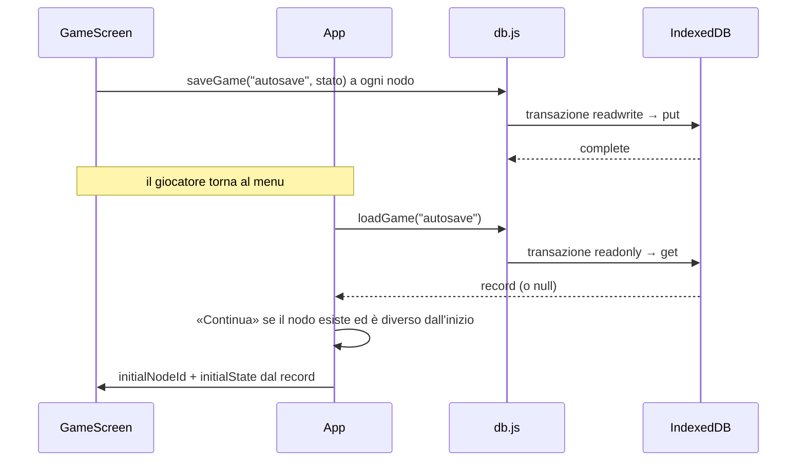

# 4. Salvataggi con IndexedDB: `src/db.js`

Questo capitolo spiega `db.js` riga per riga, perché IndexedDB è una API poco intuitiva la prima volta: è asincrona, basata su eventi e con un sistema di versioni tutto suo.

## Perché IndexedDB e non `localStorage`

| | `localStorage` | IndexedDB |
| - | -------------- | --------- |
| API | sincrona: blocca la pagina mentre legge o scrive | asincrona |
| Dati | solo stringhe (serve `JSON.stringify`) | oggetti, array, date, `Blob`: tutto ciò che si può clonare con lo *structured clone* |
| Spazio | circa 5 MB | molto di più (una quota del disco) |
| Scritture | nessuna garanzia di atomicità | **transazioni**: o va tutto a buon fine o niente |
| Schema | nessuno | versioni e migrazioni |

Per una PWA o un'app Capacitor, IndexedDB è lo standard per i dati offline.

## I concetti, in breve

```
origine (es. https://mementotest.netlify.app)
└── database "memento-db" (versione 2)
    └── object store "saves" (keyPath: "slot")      ≈ una tabella
        ├── record { slot: "autosave", nodeId: "S08", inventory: [...], flags: [...], timestamp }
        └── ... (in futuro: slot manuali)
```

- **Database**: ha un nome e un **numero di versione** intero. Ogni origine (protocollo + dominio + porta) ha i suoi database: `localhost:5173` (dev), `localhost:4173` (preview) e il sito Netlify hanno salvataggi separati.
- **Object store**: un contenitore di record, simile a una tabella. Lo si crea solo durante un aggiornamento di versione.
- **keyPath**: il campo del record che fa da chiave primaria. Qui è `slot`: scrivere un record con uno `slot` già esistente lo **sostituisce** (`put` = inserisci o aggiorna).
- **Transazione**: ogni lettura o scrittura avviene dentro una transazione, `readonly` o `readwrite`. Quando non ha più richieste in sospeso, la transazione si chiude da sola (*auto-commit*).
- **Richiesta** (`IDBRequest`): ogni operazione restituisce subito una richiesta; il risultato arriva dopo, con gli eventi `success` / `error`.

Siccome tutto è a eventi, `db.js` avvolge ogni operazione in una `Promise`: il resto dell'app usa semplicemente `await`.

## Lo schema di Memento

| Versione | Record | Note |
| -------- | ------ | ---- |
| v1 | `{ slot, nodeIdx: number, inventory, timestamp }` | il nodo era la posizione nell'array della vecchia storia demo |
| **v2** | `{ slot, nodeId: string, inventory, flags: string[], timestamp }` | nodi indirizzati per id (`"S01"`), aggiunti i flag |

Oggi si usa un solo slot: `"autosave"`.

## `openDB()`: aprire (e aggiornare) il database

```js
let dbPromise = null;

function openDB() {
  if (dbPromise) return dbPromise;          // ①
  dbPromise = new Promise((resolve, reject) => {
    const req = indexedDB.open(DB_NAME, DB_VERSION);   // ②
    req.onupgradeneeded = (e) => { ... };              // ③
    req.onsuccess = () => { ... resolve(db) };         // ④
    req.onerror = () => { dbPromise = null; reject(req.error) };  // ⑤
    req.onblocked = () => console.warn(...);           // ⑥
  });
  return dbPromise;
}
```

1. **Una connessione condivisa.** La prima chiamata apre il database; le successive riusano la stessa `Promise`. Aprire una connessione a ogni salvataggio sarebbe uno spreco e, soprattutto, le connessioni lasciate aperte **bloccano** i futuri aggiornamenti di versione (la v1 del codice aveva proprio questo difetto).
2. `indexedDB.open(nome, versione)` chiede il database in quella versione.
3. **`onupgradeneeded`** scatta solo se il database sul disco è più vecchio di `DB_VERSION`, o non esiste. È **l'unico momento in cui si può cambiare lo schema** (creare o eliminare store e indici). Gira dentro una transazione speciale di tipo `versionchange`, disponibile come `req.transaction`.
4. **`onsuccess`**: il database è pronto. Qui si registra `db.onversionchange`: se un'altra scheda apre una versione più nuova, questa scheda chiude la sua connessione (e azzera `dbPromise`, così la prossima chiamata riapre) invece di bloccare l'aggiornamento.
5. **`onerror`**: si azzera `dbPromise`, così un errore temporaneo non resta «memorizzato» per sempre e la chiamata successiva riprova.
6. **`onblocked`**: l'aggiornamento è fermo perché un'altra scheda tiene aperta una versione vecchia e non la chiude. Si avvisa in console.

### La migrazione

```js
req.onupgradeneeded = (e) => {
  const db = req.result;
  const oldVersion = e.oldVersion;          // 0 = database nuovo

  if (oldVersion < 1) {
    db.createObjectStore(STORE, { keyPath: "slot" });
  }

  if (oldVersion >= 1 && oldVersion < 2) {
    const store = req.transaction.objectStore(STORE);
    store.openCursor().onsuccess = (ev) => {
      const cursor = ev.target.result;
      if (!cursor) return;                   // finito
      if (typeof cursor.value.nodeIdx === "number") cursor.delete();
      cursor.continue();
    };
  }
};
```

Lo schema a gradini `if (oldVersion < N)` è il modo classico di scrivere le migrazioni: un utente nuovo (versione 0) esegue tutti i passi, uno che arriva dalla v1 esegue solo quelli che gli mancano. I passi non si riscrivono mai: se ne aggiungono di nuovi.

Il passo v1 → v2 usa un **cursore**, cioè un iteratore sui record dello store: `cursor.value` è il record corrente, `cursor.delete()` lo elimina, `cursor.continue()` passa al successivo (e fa scattare di nuovo `onsuccess`). I salvataggi v1 puntavano a posizioni nella storia demo, che non esiste più: non c'è niente di sensato a cui collegarli, quindi vengono eliminati. Se la storia fosse rimasta la stessa, qui si sarebbe riscritto ogni record (`record.nodeId = vecchiIds[record.nodeIdx]; cursor.update(record)`).

## `withStore()`: una transazione per operazione

```js
async function withStore(mode, fn) {
  const db = await openDB();
  return new Promise((resolve, reject) => {
    const tx  = db.transaction(STORE, mode);
    const req = fn(tx.objectStore(STORE));
    tx.oncomplete = () => resolve(req?.result);
    tx.onerror    = () => reject(tx.error);
    tx.onabort    = () => reject(tx.error);
  });
}
```

Il dettaglio importante: la `Promise` si risolve su **`tx.oncomplete`**, non sul `success` della richiesta. Una richiesta riuscita non significa ancora dati scritti su disco: la transazione potrebbe fallire dopo (per esempio per quota esaurita). Aspettando il completamento della transazione, quando `await saveGame(...)` ritorna il salvataggio è davvero durevole.

> **Insidia classica.** Dentro una transazione non si può fare `await` di qualcosa che non sia IndexedDB (un `fetch`, un `setTimeout`): appena la transazione resta senza richieste in sospeso si chiude da sola, e la richiesta successiva fallisce con `TransactionInactiveError`. Per questo `withStore` fa tutto il lavoro in modo sincrono dentro `fn`.

## L'API pubblica

| Funzione | Operazione IndexedDB | Usata da |
| -------- | -------------------- | -------- |
| `saveGame(slot, { nodeId, inventory, flags })` | `put` in `readwrite`, aggiunge `timestamp: Date.now()` | `GameScreen` a ogni cambio di nodo e al riavvio del capitolo; il grafo per «Gioca da qui» |
| `loadGame(slot)` | `get` in `readonly`; `null` se non esiste | `App`, ogni volta che si torna al menu |
| `listSaves()` | `getAll`, ordinati dal più recente | nessuno ancora (pronta per gli slot manuali) |
| `deleteSave(slot)` | `delete` | nessuno ancora |
| `clearAllSaves()` | `clear` | `App`, su «Nuova partita» |

I dati salvati passano per lo *structured clone*: inventario e flag sono oggetti e array semplici, quindi nessun problema; funzioni o istanze di classi non si potrebbero salvare.

## Il ciclo di vita di un salvataggio



Gli errori non bloccano mai il gioco: `GameScreen` scrive in console (`.catch(console.error)`), `App` tratta un errore di lettura come «nessun salvataggio».

## Guardare i dati nel browser

Chrome / Edge: **DevTools → Application → Storage → IndexedDB → memento-db → saves**. Si vedono i record, si possono cancellare singolarmente o eliminare l'intero database (utile per provare la migrazione da zero). Firefox: **Strumenti di sviluppo → Archiviazione → Indexed DB**.

## Esempio: aggiungere la v3 con le impostazioni

Oggi volume, effetti e velocità del testo si perdono ricaricando la pagina. Per salvarli serve un secondo store, quindi una nuova versione:

```js
const DB_VERSION = 3;
const STORE = "saves";
const SETTINGS = "settings";

req.onupgradeneeded = (e) => {
  // ...passi v1 e v2 invariati...

  // v2 → v3: store per le impostazioni. Nessuna keyPath: la chiave si passa
  // a mano (put(valore, "utente")), perché c'è un solo record.
  if (e.oldVersion < 3) {
    db.createObjectStore(SETTINGS);
  }
};

// withStore riceve anche il nome dello store
async function withStore(storeName, mode, fn) { /* come prima, con storeName */ }

export const saveSettings = (settings) =>
  withStore(SETTINGS, "readwrite", (s) => s.put(settings, "utente"));

export const loadSettings = async () =>
  (await withStore(SETTINGS, "readonly", (s) => s.get("utente"))) ?? null;
```

Poi in `App`: leggere le impostazioni all'avvio (unendole a `DEFAULT_SETTINGS`, così un campo nuovo ha sempre un valore) e salvarle in `onSave`. Due attenzioni:

- **`clearAllSaves` non deve toccare le impostazioni**: lavora solo sullo store `saves`, quindi va bene così.
- **Le schede aperte**: chi ha il gioco aperto in un'altra scheda con il codice vecchio tiene una connessione v2. Grazie a `onversionchange` quella scheda la chiude e l'aggiornamento procede.

## Esempio: slot di salvataggio manuali

`listSaves` e `deleteSave` sono già pronte; serve l'interfaccia (per esempio nel `SideMenu`) che chiama `saveGame("slot-1", ...)`. Una modifica necessaria: oggi «Nuova partita» chiama `clearAllSaves()`, che cancellerebbe anche gli slot manuali. Andrebbe sostituita con `deleteSave("autosave")`.
