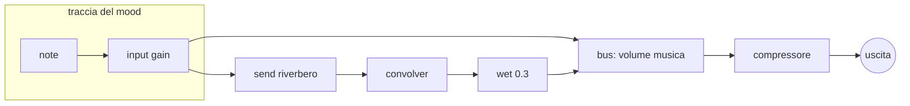

# 6. Audio

Nessun file audio: effetti e musica sono **sintetizzati al momento** con la Web Audio API. Tre moduli in `src/components/`:

| File | Ruolo |
| ---- | ----- |
| `audioContext.js` | l'unico `AudioContext`, condiviso |
| `audio.js` | effetti sonori e impostazioni audio |
| `music.js` | colonna sonora procedurale, un «mood» per tema |

## `audioContext.js`

- Crea l'`AudioContext` alla prima richiesta (`getAC()`), non al caricamento: i browser permettono l'audio solo dopo un gesto dell'utente, e il primo suono del gioco arriva sempre dopo un clic.
- Se il contesto è sospeso, lo riprende a ogni richiesta.
- **`isLowPowerDevice`**: `true` sui dispositivi senza hover (telefoni, tablet). Su questi il contesto nasce con `latencyHint: "playback"`, cioè buffer più grandi. Con i buffer piccoli di `"interactive"` una CPU da telefono carica non fa in tempo a riempirli e il suono gracchia (*buffer underrun*): è quello che succedeva prima di questa correzione.

## `audio.js`: gli effetti

Ogni effetto è una piccola sequenza di toni (oscillatore + inviluppo di volume) collegata direttamente all'uscita:

| Effetto | Quando |
| ------- | ------ |
| `sfxClick`, `sfxMenuOpen` | pulsanti, menu |
| `sfxCardHover`, `sfxCardSelect` | carte: anteprima e scelta (un arpeggio «d'arpa») |
| `sfxDiceRoll`, `sfxDiceLand(valore)` | lancio e arresto del dado (tono diverso per ogni valore) |
| `sfxClue` | comparsa di un indizio: seconda eccedente, colore «zingaresco» |
| `sfxTextReveal` | comparsa delle scelte |
| `sfxTransition` | cambio di nodo |
| `sfxPinKey`, `sfxPinError`, `sfxPinSuccess` | tastierino |
| `sfxPageTurn` | apertura della mappa |

`setAudioSettings({ sfx, volume })`, chiamata da `App`, accende o spegne gli effetti e regola il volume della **musica** (gli effetti hanno un volume fisso).

## `music.js`: la colonna sonora

### Lo stile

L'obiettivo è il colore «zingaro-vittoriano» delle colonne sonore alla Sherlock Holmes (pianoforte da salotto scordato, cimbalom, violino con glissando, pizzicato in 6/8, stop improvvisi) con un tocco irlandese (bodhrán). Il riferimento è solo di stile: **nessuna melodia è copiata**. I motivi sono generati al momento da scale di re minore armonica e re minore ungherese.

### Il mixer

- Il **bus** porta il volume scelto nelle impostazioni (moltiplicato per 0,55 di margine).
- Il **compressore** evita che i picchi saturino.
- Il **riverbero** è un convolver con una risposta all'impulso generata (rumore che decade): ogni mood decide quanto mandarci.

### Gli strumenti

Funzioni che programmano una nota al tempo `t` sull'orologio dell'`AudioContext`:

| Strumento | Tecnica |
| --------- | ------- |
| `pluck` (cimbalom, pizzicato) | **Karplus–Strong**: un buffer di rumore lungo un periodo, filtrato e retroazionato, simula una corda pizzicata. Il buffer si calcola una volta per altezza e si tiene in cache (al massimo 96) |
| `piano` | due triangoli leggermente stonati tra loro (effetto *honky-tonk*) + un'armonica, con filtro che si chiude |
| `fiddle` (violino) | dente di sega, attacco con glissando dal basso, vibrato che entra in ritardo |
| `drum` (bodhrán) | sinusoide con altezza che cade rapidamente + un po' di rumore per la bacchetta |
| `tick` | rumore filtrato: l'orologio a cucù |
| `bell` | parziali inarmoniche: campane e celesta |
| `drone` | denti di sega stonati sotto un passa-basso: bordoni |
| `rainBed` | rumore filtrato in loop: la pioggia del tema `street` |

### I mood

Ogni mood ha un tempo (`step`, secondi per croma), una progressione di accordi per battuta (`prog`), una quantità di riverbero, una probabilità di pause nella melodia e una funzione `play` che decide cosa suonare a ogni passo della battuta in 6/8.

| Mood | Carattere |
| ---- | --------- |
| `title` | arpeggi lenti di cimbalom su bordone, qualche campana |
| `hotel` | orologio, pianoforte stanco; ogni 8 battute si ferma tutto tranne l'orologio |
| `pub` | giga: bodhrán, pizzicato «um-pa-pa», violino con abbellimenti; ogni 8 battute uno stop improvviso |
| `legend` | rintocchi gravi di pianoforte, bordone dissonante, violino lento, tamburo lontano |
| `street` | pioggia continua, battito, ostinato basso pizzicato |
| `library` | scala ungherese, campane, note lunghe di violino |
| `mist` | bordone dissonante, campane casuali |

Il motivo melodico (6 note, con pause) si rigenera ogni 4 battute; un piccolo ritardo casuale (fino a 8 ms) sulle note dà un'esecuzione meno meccanica.

### Lo scheduler

Il problema: i timer JavaScript sono imprecisi (soprattutto su telefono e nelle schede in background), ma la musica ha bisogno di tempi esatti. La soluzione classica è lo **scheduler con anticipo** (*look-ahead*):

- un `setInterval` si sveglia ogni 100 ms;
- a ogni risveglio programma sull'orologio dell'`AudioContext` tutte le note che cadono nei prossimi 0,5 s;
- le note partono quindi al campione esatto, qualunque ritardo abbia avuto il timer.

Se la scheda è stata in background e lo scheduler è rimasto indietro, salta avanti invece di suonare di colpo tutte le note arretrate.

### Cambi di mood

`playMusic(tema)` crea una nuova traccia che entra in 2,5 s mentre la vecchia esce negli stessi 2,5 s (dissolvenza incrociata). La vecchia viene scollegata solo qualche secondo dopo, per non tagliare le code delle note e del riverbero. `stopMusic()` (all'uscita da `GameScreen`) ferma lo scheduler e sfuma l'ultima traccia.

### Modalità leggera (`LITE`)

Sui dispositivi `isLowPowerDevice`, a parità di musica, meno lavoro audio:

- una corda per nota invece di due nel cimbalom;
- due oscillatori invece di tre nel pianoforte e nei bordoni;
- niente passa-alto nel violino, niente rumore di bacchetta nel tamburo;
- una sola nota d'accordo nel pizzicato del pub;
- riverbero mono e più corto.

Nelle misure fatte, il gracchiare su telefono non era saturazione (il picco massimo era circa 0,5) ma carico della CPU con buffer piccoli; `latencyHint` + `LITE` lo affrontano entrambi.
